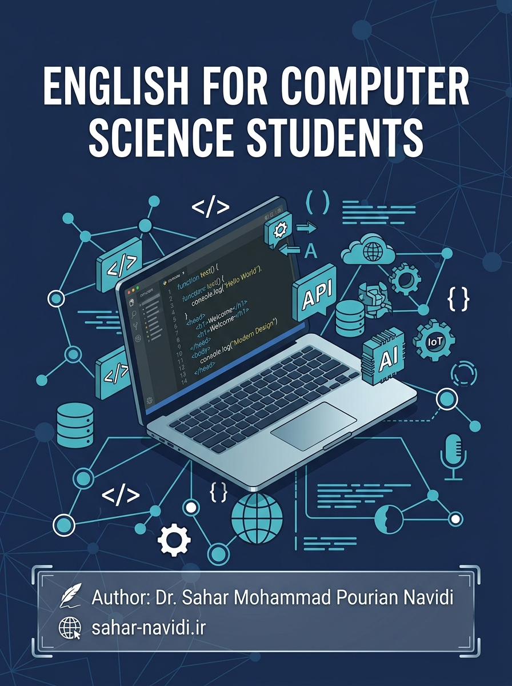

  

<h1 align="center">English for Computer Science Students</h1>
<h3 align="center">زبان تخصصی کامپیوتر: از مبتدی تا پیشرفته</h3>

  <b>نویسنده:</b> دکتر سحر محمدپوریان نویدی &nbsp;·&nbsp;
  <b>وب‌سایت:</b> <a href="https://sahar-navidi.ir">sahar-navidi.ir</a>

   &nbsp;
   &nbsp;
   &nbsp;
   &nbsp;
  

---

**کلیدواژه‌ها (فارسی):** زبان تخصصی کامپیوتر · زبان تخصصی دانشگاهی · زبان انگلیسی برای دانشجویان کامپیوتر · متن انگلیسی رشتهٔ کامپیوتر · واژگان تخصصی کامپیوتر و فناوری اطلاعات · ترجمهٔ متون تخصصی · گرامر پیشرفتهٔ انگلیسی · ESP دانشگاهی · مهندسی نرم‌افزار · هوش مصنوعی · امنیت سایبری · رایانش ابری · اینترنت اشیا · بلاک‌چین · رایانش کوانتومی · رایانش سبز

**Keywords (English):** English for Specific Purposes (ESP) · English for Computer Science · academic English · technical English · computer science vocabulary · IT English textbook · CEFR A1 to C1 · reading comprehension · academic writing · grammar for computer science · machine learning · generative AI · cybersecurity · cloud computing · DevOps · Internet of Things · blockchain · quantum computing · immersive technology · green computing · Persian–English bilingual ESP

---

## این مخزن چیست؟

**۲۴ درس مستقل، یک کتاب کامل زبان تخصصی برای دانشجویان کامپیوتر.** هر درس یک فایل Markdown جداگانه و خودبسنده است: متن انگلیسی اصیل، توضیح و دستور فارسی، واژگان با تلفظ، تمرین‌های متنوع، نکتهٔ گرامری، تمرین نگارش و پروژهٔ دست‌نویس. سطح‌بندی بر پایهٔ **CEFR** است (A1–A2، B1 و B2–C1) و موضوع‌ها دقیقاً از سرفصل‌های رشته‌های کامپیوتر، آی‌تی، مهندسی نرم‌افزار و هوش مصنوعی گرفته شده‌اند.

هدف، ساده و بلندپروازانه است: دانشجو با خواندن یک متن واقعی دربارهٔ همان چیزی که در رشته‌اش می‌خواند، **زبان را یاد بگیرد**؛ و مدرسی که سطح زبانش متوسط است بتواند این درس‌ها را **تنها و بدون توضیح شفاهی** تدریس کند. به همین دلیل همهٔ دستورالعمل‌ها، توضیح‌ها و شرط‌های تمرین‌ها فارسی و روشن نوشته شده‌اند.

---

## چرا این مجموعه ارزش دیدن دارد؟

این کتاب با دقت وسواس‌گونه‌ای ساخته شده است، و عددهایش این را نشان می‌دهد:

- **۲۴ درس، ۴۳٬۴۷۸ واژه متن انگلیسی اصیل** در **۶۲۹ پاراگراف شماره‌گذاری‌شده** — از «کامپیوتر در زندگی روزمره» تا «رایانش کوانتومی» و «اخلاق و رایانش سبز». هیچ متن آماده‌ای کپی نشده است؛ همهٔ روایت‌ها تازه‌اند و موضوع‌های فناوری‌شان به‌روز.
- **۲٬۲۹۵ واژهٔ کلیدی** در قالب جدول‌های موضوعی؛ برای هر واژه: تلفظ IPA، تلفظ با الفبای فارسی، تعریف انگلیسی ساده، یک مثال واقعی و معادل فارسی. **هر واژه دقیقاً در متن همان درس آمده است** — یعنی واژه‌ای که یاد می‌گیرید، همان واژه‌ای است که در متن دیده‌اید، نه فهرست حفظمحور.
- **۳٬۵۷۰ تمرین** (۳٬۰۹۰ تمرین شماره‌دار و ۴۸۰ ردیف جدول تطبیق): جای خالی، چهارگزینه‌ای، صحیح/غلط، تطبیق، معادل‌یابی، اصلاح خطا، تبدیل جمله، ترجمهٔ دوطرفه، جمله‌سازی آزاد و تمرین پیشوند/پسوند. در کل کتاب **۲۴۰ پرسش چهارگزینه‌ای** و **۲۴۰ جملهٔ صحیح/غلط** دارید — کافی برای یک ترم کار جدی.
- **۲۴ نکتهٔ گرامری پله‌ای، بدون تکرار:** از فعل *be* و حال ساده تا شرطی‌های ترکیبی، مجهول پیشرفته، وارونگی، نقل قول، جمله‌واره‌های اسمی و لحن محتاطانه در نوشتار دانشگاهی — یک نکته در هر درس، دقیقاً در همان جایی که به آن نیاز دارید.
- **۲۴ تمرین نگارش** در محدودهٔ واژه‌ی سنجیده و **۲۴ پروژهٔ نیمه‌تحقیقی** که دانشجو باید روی کاغذ بکشد، بنویسد و تحویل بدهد؛ پروژه‌ها شخصی‌سازی‌شده‌اند تا پاسخ دادن به آن‌ها با متن آماده یا ابزار هوش مصنوعی سخت باشد.
- **۱۹۲ واقعیت «آیا می‌دانستید؟»** دوزبانه، به‌روز و با لحن محتاطانه و مستند — بخشی که کلاس را زنده می‌کند.
- **ساختار یکسان در هر ۲۴ درس:** دقیقاً ۱۱ بخش با همان ترتیب. دانشجو بعد از درس اول دیگر لازم نیست بپرسد «بعدش چه؟»؛ مدرس هم می‌داند هر جلسه چه چیزی در انتظارش است.
- **متن انگلیسی، دستور فارسی:** انگلیسی متن با سطح همان درس نوشته شده و فارسی توضیح‌ها ساده و بدون اصطلاحات گنگ. هیچ بخشی وابسته به بحث آزاد کلاسی یا ترجمهٔ هم‌زمان مدرس نیست.

> این مجموعه حاصل ماه‌ها کار پیوسته روی متن، واژگان، تمرین و ارزیابی است. هر درس بارها بازبینی، شمارش و اصلاح شده تا سه چیز تضمین شود: **صحت زبان**، **هم‌خوانی واژگان با متن**، و **تدریس‌پذیری مستقل**. اگر فقط یک درس را باز کنید و متن آن را بخوانید، تفاوت این دقت را می‌بینید.

---

## درس‌ها

| درس | عنوان انگلیسی | عنوان فارسی | سطح | واژهٔ متن | واژگان کلیدی |
|---|---|---|---|---|---|
| [۱](lesson-01-computers-daily-life.md) | Computers in Our Daily Life | کامپیوتر در زندگی روزمره | A1–A2 | ۹۹۸ | ۷۵ |
| [۲](lesson-02-smartphones-and-tablets.md) | Smartphones and Tablets | گوشی‌های هوشمند و تبلت‌ها | A1–A2 | ۹۰۶ | ۷۵ |
| [۳](lesson-03-internet-and-wifi.md) | The Internet and Wi-Fi | اینترنت و وای‌فای | A1–A2 | ۸۲۲ | ۷۵ |
| [۴](lesson-04-apps-and-online-services.md) | Apps and Online Services | اپلیکیشن‌ها و سرویس‌های آنلاین | A1–A2 | ۷۹۴ | ۷۵ |
| [۵](lesson-05-files-folders-cloud-storage.md) | Files, Folders, and Cloud Storage | فایل‌ها، پوشه‌ها و فضای ابری | A1–A2 | ۸۴۷ | ۷۵ |
| [۶](lesson-06-email-chat-video-calls.md) | Email, Chat, and Video Calls | ایمیل، چت و تماس تصویری | A1–A2 | ۷۷۷ | ۷۵ |
| [۷](lesson-07-safe-browsing-and-passwords.md) | Safe Browsing and Passwords | مرور امن و رمز عبور | A1–A2 | ۸۵۱ | ۷۵ |
| [۸](lesson-08-digital-skills-study-work.md) | Digital Skills for Study and Work | مهارت‌های دیجیتال برای تحصیل و کار | A1–A2 | ۷۹۲ | ۷۵ |
| [۹](lesson-09-how-computer-networks-work.md) | How Computer Networks Work | شبکه‌های کامپیوتری چگونه کار می‌کنند | B1 | ۱٬۵۷۶ | ۹۰ |
| [۱۰](lesson-10-cloud-computing-and-data-centers.md) | Cloud Computing and Data Centers | رایانش ابری و مراکز داده | B1 | ۱٬۵۳۱ | ۹۰ |
| [۱۱](lesson-11-programming-languages-and-code.md) | Programming Languages and Code | زبان‌های برنامه‌نویسی و کد | B1 | ۱٬۵۸۶ | ۹۰ |
| [۱۲](lesson-12-websites-apps-and-apis.md) | Websites, Apps, and APIs | وب‌سایت‌ها، اپ‌ها و APIها | B1 | ۱٬۵۴۲ | ۹۰ |
| [۱۳](lesson-13-databases-and-information-systems.md) | Databases and Information Systems | پایگاه داده و سیستم‌های اطلاعاتی | B1 | ۱٬۶۸۰ | ۹۰ |
| [۱۴](lesson-14-cybersecurity-basics.md) | Cybersecurity Basics | مبانی امنیت سایبری | B1 | ۱٬۵۴۰ | ۹۰ |
| [۱۵](lesson-15-artificial-intelligence-around-us.md) | Artificial Intelligence Around Us | هوش مصنوعی در اطراف ما | B1 | ۱٬۶۴۰ | ۹۰ |
| [۱۶](lesson-16-internet-of-things-and-smart-devices.md) | Internet of Things and Smart Devices | اینترنت اشیا و دستگاه‌های هوشمند | B1 | ۱٬۷۲۳ | ۹۰ |
| [۱۷](lesson-17-machine-learning-and-deep-learning.md) | Machine Learning and Deep Learning | یادگیری ماشین و یادگیری عمیق | B2–C1 | ۳٬۱۰۷ | ۱۱۹ |
| [۱۸](lesson-18-generative-ai-and-llms.md) | Generative AI and Large Language Models | هوش مصنوعی مولد و مدل‌های زبانی بزرگ | B2–C1 | ۲٬۸۷۷ | ۱۱۸ |
| [۱۹](lesson-19-cloud-native-devops-and-microservices.md) | Cloud-Native, DevOps, and Microservices | کلاود-نیتیو، دواپس و میکروسرویس‌ها | B2–C1 | ۲٬۹۶۸ | ۱۲۱ |
| [۲۰](lesson-20-advanced-cybersecurity-and-zero-trust.md) | Advanced Cybersecurity and Zero Trust | امنیت سایبری پیشرفته و اعتماد صفر | B2–C1 | ۳٬۰۴۵ | ۱۲۳ |
| [۲۱](lesson-21-blockchain-web3-and-digital-trust.md) | Blockchain, Web3, and Digital Trust | بلاک‌چین، وب ۳ و اعتماد دیجیتال | B2–C1 | ۳٬۱۴۶ | ۱۲۲ |
| [۲۲](lesson-22-quantum-computing-and-future-hardware.md) | Quantum Computing and Future Hardware | رایانش کوانتومی و سخت‌افزار آینده | B2–C1 | ۲٬۹۰۹ | ۱۲۴ |
| [۲۳](lesson-23-ar-vr-metaverse-and-immersive-tech.md) | AR/VR, Metaverse, and Immersive Tech | واقعیت افزوده و مجازی، متاورس و فناوری غوطه‌ور | B2–C1 | ۲٬۹۱۵ | ۱۲۴ |
| [۲۴](lesson-24-ethics-privacy-and-green-computing.md) | Ethics, Privacy, and Green Computing | اخلاق، حریم خصوصی و رایانش سبز | B2–C1 | ۲٬۹۰۶ | ۱۲۴ |

**گرامر هر درس، به ترتیب:** فعل *be* و این/آن ← حال ساده ← *there is/are* و حروف اضافهٔ مکان ← *have/has* و صفت‌ها ← اسم‌های جمع ← حال استمراری ← *can* و جملهٔ امری ← گذشتهٔ ساده ← حال کامل ← آینده ← صفت‌های تفضیلی و عالی ← افعال وجهی ← مجهول ← شرطی نوع اول ← جمله‌های موصولی ← اسم مصدر و مصدر با *to* ← شرطی نوع دوم ← شرطی نوع سوم ← نقل قول ← مجهول پیشرفته ← جمله‌واره‌های اسمی ← وارونگی ← شرطی‌های ترکیبی ← ابزارهای انسجام و لحن محتاطانه.

---

## ساختار هر درس (۱۱ بخش ثابت)

۱. **اهداف درس** — ۳ تا ۵ هدف فارسی
۲. **واژگان کلیدی** — جدول‌های موضوعی واژگان با تلفظ دوزبانه
۳. **متن اصلی** — متن انگلیسی + پاراگراف‌های شماره‌گذاری‌شده + شمارش واژه
۴. **ترجمهٔ فارسی** — بر پایهٔ سطح درس (ترجمهٔ کامل / پاراگراف‌های کلیدی / واژه‌های دشوار و نکات ترجمه)
۵. **درک مطلب** — ۱۰ چهارگزینه‌ای، ۱۰ صحیح/غلط، ۶ پاسخ کوتاه، ۲ ایدهٔ اصلی، ۲ جدول تطبیق
۶. **تمرین واژگان** — ۲۰ جای خالی، ۱۰ تطبیق، ۱۰ جمله‌سازی، ۱ تمرین پیشوند/پسوند
۷. **نکتهٔ گرامری** — توضیح فارسی + جدول‌های فرمول + مثال‌های کامپیوتری + ۴۰ تمرین
۸. **ترجمهٔ جمله‌های کلیدی** — ۱۰ انگلیسی ← فارسی و ۱۰ فارسی ← انگلیسی
۹. **تمرین نگارش** — موضوع شخصی با محدودهٔ واژه و «شرایط نگارش»
۱۰. **پروژهٔ کوچک** — انشای نیمه‌تحقیقی، دست‌نویس و تحویل‌دادنی در جلسهٔ بعد
۱۱. **آیا می‌دانستید؟** — ۸ واقعیت دوزبانه و به‌روز

هر فایل درس **بدون پاسخ‌نامه** منتشر شده است تا مستقیم در اختیار دانشجو قرار بگیرد. مدرسانی که پاسخ تمرین‌ها را می‌خواهند، می‌توانند از راه [وب‌سایت نویسنده](https://sahar-navidi.ir) درخواست کنند.

---

## چطور از این درس‌ها استفاده کنیم؟

**برای دانشجو:** هفته‌ای یک درس. اول متن را بدون فرهنگ لغت بخوانید، بعد واژگان را ببینید، بعد تمرین‌ها را حل کنید و آخر هفته انشا را دست‌نویس بنویسید. اگر یک درس را درست تمام کنید، حدود ۹۰ تا ۱۲۴ واژهٔ تازهٔ کاربردی و یک نکتهٔ گرامری را در ذهن دارید.

**برای مدرس:** هر درس یک کتابچهٔ کامل برای یک جلسهٔ ۹۰ تا ۱۲۰ دقیقه‌ای است. دستورهای تمرین‌ها فارسی‌اند، پس نیازی به توضیح شفاهی انگلیسی نیست. اهداف درس ساده و قابل ارزشیابی‌اند و پروژهٔ هر درس دست‌نویس تحویل گرفته می‌شود.

**برای مطالعهٔ خودآموز:** ترتیب درس‌ها پله‌ای است؛ ولی اگر فقط به یک حوزهٔ خاص نیاز دارید، هر درس مستقل هم خواندنی است (مثلاً درس‌های ۱۷ تا ۲۴ برای هوش مصنوعی، امنیت، ابر و بلاک‌چین).

برای تبدیل فایل‌ها به PDF یا Word کافی است هر فایل Markdown را در ویرایشگر دلخواه خود باز کنید؛ ساختار جدول‌ها به‌گونه‌ای نوشته شده که در تبدیل به هم نریزد.

---

## نویسنده

  <b>دکتر سحر محمدپوریان نویدی</b> 
  وب‌سایت: <a href="https://sahar-navidi.ir">sahar-navidi.ir</a>

این مجموعه با صبر و دقت فراوان نوشته شده است: از انتخاب موضوع و سطح متن تا شمارش واژه‌ها، بررسی واژه‌به‌واژهٔ هم‌خوانی متن و جدول‌ها، سنجش طول توضیح‌های فارسی، و کنترل توزیع پاسخ‌های چهارگزینه‌ای. اگر برایتان مفید بود، خوشحال می‌شویم در [وب‌سایت](https://sahar-navidi.ir) یا در بخش Issues همین مخزن بازخوردتان را بنویسید.

---

## English summary

**English for Computer Science Students** is a free, open, bilingual (English–Persian) ESP course of **24 self-contained lessons** for computer-science, IT, software-engineering and AI students. It covers **three CEFR bands** — A1–A2 (lessons 1–8), B1 (lessons 9–16) and B2–C1 (lessons 17–24) — with **43,478 words of original reading text**, **2,295 key vocabulary entries** (IPA + Persian transliteration + definition + example), **3,570 exercise items**, **24 grammar points** in a graded sequence with no repetition, **24 writing tasks**, **24 handwritten mini projects**, and **192 bilingual “Did you know?” facts**.

Every lesson is a standalone booklet with the same 11 sections, and it is written so that **an instructor with basic English can teach it alone**: all instructions and explanations are in simple Persian, while the reading text is authentic academic English. Lesson topics follow modern CS curricula: from computers in daily life, the internet and the web, to databases, cybersecurity, cloud computing, machine learning, generative AI, DevOps, zero trust, blockchain, quantum computing, immersive technology, and green computing.

Author: **Dr. Sahar Mohammad Pourin Navidi** — <https://sahar-navidi.ir>

Contributions are welcome: open an issue or send a pull request, keeping the 11-section structure, the Persian instructions, and the rule that answers never appear inside a lesson file.

**Keywords:** ESP, English for Specific Purposes, English for Computer Science, academic English, technical English, CS vocabulary, CEFR, reading comprehension, academic writing, grammar, Persian–English bilingual textbook, machine learning, generative AI, LLM, cybersecurity, zero trust, cloud-native, DevOps, microservices, blockchain, Web3, quantum computing, AR/VR, metaverse, ethics, privacy, green computing.
